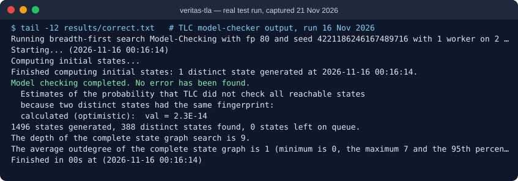

# veritas-tla — a machine-checked proof for credential revocation — manual

*One page, eight blocks. Every figure here comes from this repository's own tests and README.*

## 1. Claim
TLC explores all 388 reachable states and finds no state where a revoked or expired credential verifies. Removing either guard produces a counterexample trace.

## 2. What it is
A formal model of the Veritas verifier, checked exhaustively by a model checker. It proves the revocation and expiry checks are correct under every ordering of events, and that each check is necessary.

## 3. Demo
The TLC transcripts in `results/` (`correct.txt`, `no_revocation.txt`, `no_expiry.txt`).


*Real output from this repository's own tests, captured 21 Nov 2026.*

## 4. Run it yourself
**Prerequisites:** A JVM. `run-checks.sh` downloads tla2tools.jar if needed.

```bash
bash run-checks.sh
```

## 5. What you will see
The correct config reports no error across 388 distinct states (depth 9). The two reduced configs each produce their counterexample. The script fails unless all three behave as stated.

## 6. 30-second talking point
> "We check revocation" is a claim. "Removing the revocation check is provably unsafe, and here is the trace" is evidence. Lifecycle bugs live in the ordering of events, and a model checker tries every ordering.

## 7. Scope and limits
- A bounded model (2 credentials, time horizon 3). Exhaustive for that space, not a proof for unbounded parameters.
- Cryptographic soundness is abstracted. The signature layer is verified separately in Veritas.

## 8. Links
[Repository](https://github.com/fhionnghaile/veritas-tla) · [Write-up](https://padraigfhionnghaile.com/work/veritas-tla/) · [README](README.md)
